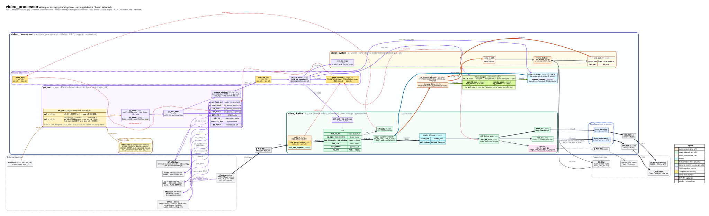
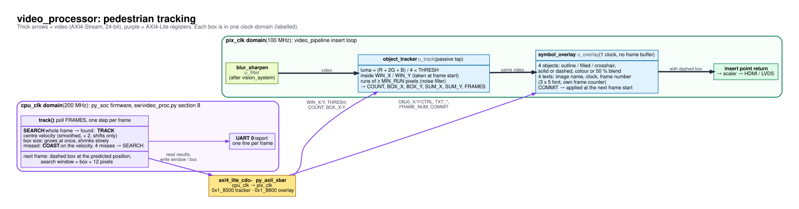
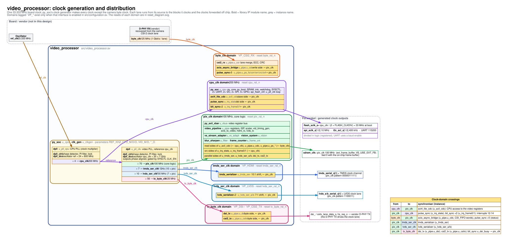
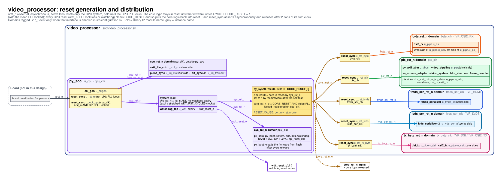

# video_processor

Top level of a complete video processing system, built from the IP library
(`../../ip`) and `../vision_system`:

- **Camera input**: MIPI CSI-2 into `video_pipeline` (ISP).
- **Lens correction**: `vision_system` at the pipeline's insert point.
- **Blur / sharpen**: `blur_sharpen` after `vision_system` in the same
  insert loop, with modes for blur, sharpen, sharpen then blur, blur then
  sharpen, and pass-through.
- **Object detection, tracking and symbol overlay**: four `object_tracker`
  detectors, one per object class (pedestrian, face, automobile, other
  vehicle), each find their class's pixels (luma threshold or colour
  ranges, run widths) and split them into up to 4 separate objects (blobs)
  in every frame; the firmware checks each object's shape, tracks up to 3
  targets per class (at most `TARGETS` in all) from frame to frame, and
  `symbol_overlay` draws a box per target over the video (pedestrian green,
  face magenta, automobile cyan, vehicle orange; dashed or solid rectangle,
  circle or oval, or a solid box in the middle of a large target, chosen
  per class).
- **Scaler and outputs**: HDMI / DVI and LVDS outputs (MIPI DSI / CSI-2 optional).
- **Control**: a `py_soc` CPU that boots Python firmware from SPI flash and
  programs everything through its external register window. Its external
  interfaces are 2x UART, 2x I2C, 2x SPI, 96 GPIO and the SPI flash.

No target device or board is selected: the design is technology
independent. A board wrapper adds the PLL, the vendor D-PHYs and the
differential I/O buffers.



`docs/block_diagram.svg` shows the video datapath (`u_pipe` and the
serializers) in more detail, `docs/tracking_diagram.svg` the tracking loop.



### Clocks and resets

One board clock, `ref_clk` (33.333 MHz), feeds the clock generator in the
CPU system (`py_soc` `u_clkgen`, [`ip/clock/clk_gen`](../../ip/clock/clk_gen)):
two all-digital PLLs ([`ip/clock/dpll`](../../ip/clock/dpll)) make every
clock of the design except the camera byte clock, which the D-PHY RX
recovers from the camera.

| Clock | Default | Ratio (parameters) | Used by |
|-------|---------|--------------------|---------|
| `cpu_clk` | 200 MHz | ref × `CPU_M` / (`CPU_D` × `CPU_O`) = × 24 / 4 (CPU PLL oscillator 800 MHz) | `py_soc`, CPU side of the crossings |
| `pix_clk` | 100 MHz | `cpu_clk` × `VID_M` / (`VID_D` × `PIX_O`) = × 35 / 70 (video PLL oscillator 7 GHz) | core logic: video pipeline, registers, vision_system, blur_sharpen, SDRAM |
| `tmds_ser_clk` | 1 GHz | ÷ `TMDS_O` = 7 (10 × `pix_clk`) | HDMI serializer |
| `lvds_ser_clk` | 700 MHz | ÷ `LVDS_O` = 10 (7 × `pix_clk`, single link; 20 for dual link) | LVDS serializers |
| `tx_byte_clk` | 125 MHz | ÷ `TXB_O` = 56 | MIPI DSI / CSI-2 TX (1 Gbit/s per lane) |
| `byte_clk` | 125 MHz | input from the D-PHY RX | CSI-2 RX |

The video PLL outputs share one oscillator, so the serial clocks are phase
aligned with `pix_clk` (as the serializers require). SYSCTL `CLK_EN`
(0x0114) gates each video clock: the core and MIPI byte clocks run from
reset, the firmware turns the display serial clocks on at its video set-up.
`CLK_STATUS` (0x0118) shows the lock.

Each CPU peripheral has its own parameter set (rate, and the TX / RX FIFO
depths of its `py_stream_port`, 16 words by default):

| Peripheral | Use | Rate parameter | Default |
|------------|-----|----------------|---------|
| UART 0 | debug console | `UART0_BAUD` | 115200 baud |
| UART 1 | host / control link | `UART1_BAUD` | 115200 baud |
| I2C 0 | camera sensor CCI | `I2C0_HZ` | 400 kHz (fast mode) |
| I2C 1 | HDMI DDC / EDID, EEPROM | `I2C1_HZ` | 100 kHz (standard mode) |
| SPI 0 | panel initialisation / touch | `SPI0_HZ`, `SPI0_DATA_W` | 10 MHz, 16-bit words |
| SPI 1 | ADC, sensors | `SPI1_HZ`, `SPI1_DATA_W` | 2 MHz, 16-bit words |
| SPI NOR flash | firmware | `FLASH_CLKDIV` | 3 (33 MHz at boot) |

FIFO parameters: `UART0_TX_FIFO` / `UART0_RX_FIFO`, ... `FLASH_TX_FIFO` /
`FLASH_RX_FIFO`. The testbench overrides the rates for a short simulation.

For synthesis only the PLL oscillators (`dpll_dco`, oscillator + phase
read-out) are black boxes; the loop logic (`dpll_ctrl`) is synthesizable.
On an FPGA, replace them, or `clk_gen`, with the device PLL / MMCM. The
7 GHz video oscillator suits the simulation model; a device PLL would use
separate outputs per ratio.



`arst_n` resets only the CPU system (`py_soc`), held until its CPU PLL
locks. The core logic is released by the firmware through SYSCTL
`CORE_RESET` (`core_rst_n_o`, only while the video PLL is locked),
synchronised once per clock domain by `reset_sync`; every CPU reset
(`arst_n`, loss of lock or the watchdog) clears `CORE_RESET` again.



## Directory structure

| Path | Contents |
|------|----------|
| `src/configuration.sv` | interfaces built: `VP_CSI2_RX`, `VP_HDMI`, `VP_LVDS`, `VP_DSI`, `VP_CSI2_TX`, `VP_VISION`, `VP_FILTER`, `VP_TRACK` (the last three imply `VP_INSERT`) |
| `src/video_processor.sv` | top level |
| [`../../ip/video/vs_stream_adapter`](../../ip/video/vs_stream_adapter) | library IP: glue between the insert point and vision_system |
| [`../../ip/video/frame_counter`](../../ip/video/frame_counter) | library IP: frame counters with end-of-frame interrupts (frames out of the first pipeline stage and into the last one) |
| [`../../ip/video/object_tracker`](../../ip/video/object_tracker) | library IP: target search / measurement: bounding box, count and sums of the object pixels in a search window, per frame |
| [`../../ip/video/symbol_overlay`](../../ip/video/symbol_overlay) | library IP: symbols drawn over the video stream: 4 objects, rectangle outline / filled / crosshair, solid or dashed, colour or blend |
| `sw/video_proc.py` | firmware: the program (interrupt handler, `main`); imports the modules below, `pyc.py` builds one flash image from all of them |
| `sw/video_init.py` | CPU initialisation (boot report, peripheral self-test, CPU register dump, UART text output), sections 1-3 |
| `sw/video_regs.py` | addresses, register offsets and bit values of the video blocks |
| `sw/camera.py` | camera control over I2C 0 (frame gap, frame size, image name, detection options, stream on), image format pin and ISP format |
| `sw/video_setup.py` | `frame_size`, video set-up (section 4), video start (section 6) |
| `sw/video_dump.py` | video register display at the end of the set-up (section 5) |
| `sw/events.py` | frame event transcript from `frame_counter`'s event log: one line per event, in the order they happened, with the time |
| `sw/sequence.py` | frame counters and image sequence (section 7) |
| `sw/search.py` | detector search windows (the whole frame) |
| `sw/tracker.py` | the four detectors' class profiles, the shape check, blob-to-target matching and the SEARCH / TRACK / COAST state machine (up to 3 targets per class, state in the detector's scratch words) |
| `sw/overlay.py` | `symbol_overlay`: a box per target (class colour and style: box, circle or oval) and the texts |
| `sw/tracking.py` | object detection and tracking (section 8) |
| `scripts/build.f` | RTL file list (`configuration.sv` first), relative to this directory |
| `scripts/run_sim.sh` | compile the firmware, run the system test (Icarus), `--lint` for Verilator |
| `tb/` | `video_processor_tb.sv` system test, its test tasks in `tb/tests/video_processor_tests.sv`, `tb/scripts/build.f`; it also uses the library testbench models `ip/video/video_tb_lib/gif_io.sv` (animated GIF reader / writer) and `track_ref.sv` (tracker and overlay models) |
| `tb/images/` | `pedestrian_walk.gif`: the default tracking input (128 × 96, 50 frames, 5 s, black-and-white street video); `street_scene.gif`: colour street with one object of every class (160 × 120, 30 frames); `<name>.truth.txt` their true boxes (the testbench judges tracking against them); other GIFs to try (`bouncing-ricochets.gif`, ...); camera videos (`*.mp4`: street traffic, crowds, planes; 1080p and 4K, landscape and portrait) |
| `tb/scripts/make_pedestrian_gif.py` | regenerates `pedestrian_walk.gif` (pure Python) |
| `tb/scripts/make_street_gif.py` | regenerates `street_scene.gif` and its truth file (pure Python) |
| `tb/scripts/mp4_io.py` | the testbench's MP4 reader / writer (PyAV, `python3 -m pip install av`): `to-gif` samples a camera video (MP4, MOV, MKV, WebM; H.264, HEVC, ...) at a frame rate from a start time, fits it to 320 × 240 and writes the GIF the testbench sends; `to-mp4` writes a tracked GIF as H.264 MP4; `info`. `run_sim.sh` calls it for `--gif=<video>` |
| `python-prototype/` | `detect_proto.py`: Python prototype of the edge / motion detection (the model the RTL follows), its tracked GIFs, feature views and results (`python-prototype/README.md`) |
| `synth/run_yosys.sh` | Yosys Xilinx 7-series synthesis (sv2v + library flow) |
| `docs/` | `system_block_diagram.*`, `block_diagram.*`, `clock_diagram.*`, `reset_diagram.*`, `tracking_diagram.*` (`.dot` is the source) |
| `constraints/` | board constraints (once a board is chosen) |
| `include/` | shared packages (none yet) |
| `ci/run_checked.sh` | pass/fail from the log, used by the Makefile |

## Usage

`make help` prints the same summary. Every option is `NAME=value` on the `make` command line;
`scripts/run_sim.sh` takes the equivalent `--` switches (last column).

### Targets

| Command | What it does |
|---------|--------------|
| `make help` | print the targets, options and examples |
| `make sim` | system test (Icarus): firmware boot, camera → ISP → vision_system → blur_sharpen → tracker / overlay → HDMI / LVDS, image test, tracking GIF; fails on a bad result |
| `make wave` | the system test with a VCD dump, opened in the Surfer waveform viewer (pass or fail) |
| `make list-tests` | name and description of every test the system test runs |
| `make lint` | Verilator lint of the RTL (warnings only) |
| `make ip-test` | the library `video_pipeline` system testbench (bit-exact ISP model, every output) |
| `make synth` | Yosys Xilinx 7-series synthesis → `build/yosys` |
| `make cov` | sim + ip-test with Verilator code coverage → `build/coverage/summary.txt` |
| `make ci` | sim + ip-test + synth |
| `make diagram` | re-render `docs/*.dot` → `.svg` / `.png` (Graphviz) |
| `make clean` | remove `build/` and `ci/logs/` |

### Simulation options (`sim`, `wave`, `cov`)

| Option | Description | `run_sim.sh` |
|--------|-------------|--------------|
| `QUICK=1` | skip the register dumps of sections 3 and 5 in the firmware report (GPIO0[31] strap): about 3 h faster; the set-up old / new value reports still run | `--quick` |
| `IDEAL_PLL=1` | clock generator PLLs as ideal clock toggles at the exact ratios: faster, PLL lock behaviour not modelled | `--ideal-pll` |
| `VCD=1` | dump all signals to `build/sim/video_processor_tb.vcd` (large: use with a window) | `--vcd` |
| `VCD_START_US=<n>` | start the VCD dump at n µs of simulated time (with `VCD=1` or `make wave`) | `--vcd-start=<n>` |
| `VCD_STOP_US=<n>` | stop the VCD dump at n µs of simulated time (with `VCD=1` or `make wave`) | `--vcd-stop=<n>` |
| `GIF=<file>` | tracking test input: any animated GIF (default `tb/images/pedestrian_walk.gif`); its size sets the frame size, fitted to 320 × 240; a relative path is from this directory. Several GIFs, comma separated, are sent one after the other in one run (boot and image test once; every block set up again for each GIF, each with its own tracked GIF and transcript) | `--gif=<file>[,<file>...]` (or `GIF_IN=<file>` in the environment) |
| `GIF_BW=1` | convert a colour input GIF to black and white (BT.601 luma); without it a colour GIF runs through the pipeline in colour (RGGB mosaic, ISP demosaic) | `--gif-bw` |
| `GIF_FRAMES=<n>` | send only the first n frames of the tracking GIF (shorter run; default every frame) | `--gif-frames=<n>` |
| `GIF_FIRST=<n>` | start at frame n of the GIF (0 = the first); with `GIF_FRAMES`, a long GIF can run in parts side by side (results named `<name>_from<n>`) | `--gif-first=<n>` |
| `DETECT=<classes>` | object classes to detect and track, comma separated: `pedestrian`, `face`, `automobile` (`car`), `vehicle` (`bus`, `truck`), or `all`; default `pedestrian` | `--detect=<classes>` |
| `BOX=<style>` | box round every tracked object: `dashed-box`, `solid-box`, `dashed-circle`, `solid-circle`, `dashed-oval`, `solid-oval` (an ellipse inside the box), `solid-centre` (a solid box in the middle of the target, a quarter of its size: large targets such as cars and trains are marked, not outlined); default `dashed-box` for pedestrians and faces, `solid-centre` for automobiles and vehicles | `--box=<style>` |
| `BOX=<class>:<style>,...` | a style per class, e.g. `BOX=face:solid-circle,car:dashed-box`; classes not named keep the default (a plain style first sets every class: `BOX=solid-box,face:dashed-circle`) | `--box=<class>:<style>,...` |
| `TARGETS=<n>` | most targets tracked at any time, all classes together (1–12, default 12; up to 3 per class, each with its own box) | `--targets=<n>` |
| `DIRECT_LOG=1` | direct transcript: the firmware writes only the tracking (search / track lines with the overlay boxes, the summary), one character per GPIO1 write that the testbench writes straight to the transcript, instead of the whole report over UART 0; register dumps skipped. Much faster | `--direct-log` |

Box colours are fixed per class: pedestrian green, face magenta, automobile cyan, vehicle orange.

`scripts/run_sim.sh --lint` runs the Verilator lint and `--list-tests` lists the tests, as the
make targets do.

### Results (`build/sim/`)

| File | Contents |
|------|----------|
| `video_processor_tb.log` | simulation log, ends with TEST PASSED / TEST FAILED |
| `sim_transcript_<GIF name>.txt` | the firmware's report (UART 0, or only the tracking with `DIRECT_LOG=1`), written line by line while the simulation runs (there even when a run is stopped), e.g. `sim_transcript_pedestrian_walk.txt`; with several GIFs `sim_transcript_<name>+<name>...txt` and each GIF's section 8 in `sim_transcript_<GIF name>.txt` |
| `output_images/<module>_<c\|m>_<n>_output.ppm` | image test: every image at every module output |
| `gif-input/<name>_<w>x<h>.gif` | the tracking sequence as the camera sent it (`<name>_bw.gif` too when converted) |
| `gif-output/<name>_tracked.gif` | the HDMI output with the tracking boxes, same frame times as the input |
| `video-output/<name>_tracked.mp4` | a video input's tracked output as H.264 MP4 (every pixel 2 × 2) |

### Examples

```
make sim                                                     # full system test, default pedestrian GIF (long: real PLL models)
make sim QUICK=1 IDEAL_PLL=1                                 # fastest full run
make sim QUICK=1 IDEAL_PLL=1 GIF_FRAMES=6                    # quick check of the tracking flow on the first 6 GIF frames
make sim GIF=$HOME/clips/walk.gif                            # track in your own GIF (colour stays colour)
make sim GIF=$HOME/clips/walk.gif GIF_BW=1                   # your own colour GIF, converted to black and white first
make sim GIF=../my_clips/street.gif GIF_FRAMES=20 QUICK=1    # relative path (from this directory), first 20 frames
make sim VCD=1 VCD_START_US=2000 VCD_STOP_US=2200            # waveforms of a 200 µs window only
make wave QUICK=1 IDEAL_PLL=1 VCD_START_US=2000 VCD_STOP_US=2100   # same, then open Surfer
make cov QUICK=1                                             # coverage of the quick run
make sim QUICK=1 IDEAL_PLL=1 GIF=tb/images/street_scene.gif DETECT=all          # every class in the test street
make sim QUICK=1 IDEAL_PLL=1 GIF=tb/images/street_scene.gif DETECT=all BOX=solid-circle   # every class, solid circles
make sim QUICK=1 IDEAL_PLL=1 GIF=tb/images/bouncing-ricochets.gif DETECT=car,vehicle      # cars and buses in real footage
make sim QUICK=1 IDEAL_PLL=1 DETECT=pedestrian,face BOX=pedestrian:solid-box,face:dashed-circle   # a style per class
make sim IDEAL_PLL=1 DIRECT_LOG=1 DETECT=all TARGETS=6 GIF=tb/images/street_scene.gif,tb/images/go-fast.gif   # two GIFs in one run, fast transcript
scripts/run_sim.sh --quick --ideal-pll --gif=tb/images/street_scene.gif --detect=face,car --box=face:solid-circle
scripts/run_sim.sh --quick --ideal-pll --gif=walk.gif --gif-bw --gif-frames=10   # the same options without make
make sim QUICK=1 IDEAL_PLL=1 DIRECT_LOG=1 DETECT=all GIF=tb/images/2103099-uhd_3840_2160_30fps.mp4 GIF_FRAMES=20   # a video: 2 s at 10 fps
make sim QUICK=1 IDEAL_PLL=1 DIRECT_LOG=1 DETECT=all GIF=clip.mp4 VIDEO_FPS=5 VIDEO_START=12 GIF_FRAMES=10       # 2 s from 12 s, 5 fps
```

## Blocks

| Instance | IP module | Function |
|----------|-----------|----------|
| `u_cpu` | `py_soc` (`clk_gen` (`dpll` ×2: `dpll_ctrl`, `dpll_dco`), `py_core`, `py_boot`, `py_axil_xbar`, `spi_flash_ctrl`, `uart_top` ×2, `i2c_top` ×2, `spi_top` ×2, `gpio_top` ×3, `intc_top`, `watchdog_top`, `py_sysctl`, `py_stream_port`) | CPU system: every clock (`CLKGEN_EN = 1`), control CPU, `EXT_EN = 1` |
| `u_axil_cdc` | `axi4_lite_cdc` | CPU register access cpu_clk → pix_clk |
| `u_vbus` | `py_axil_xbar` (`axi4_lite_decoder`) | video register bus |
| `u_irq_stats` | `pulse_sync` | statistics-done interrupt pix_clk → cpu_clk |
| `u_frame_cnt` | `frame_counter` (`ip_axil_regs`) | COUNT0: frames out of `csi2_raw_unpack` (first stage), COUNT1: frames into `axis_to_video` (last stage); an end-of-frame interrupt per counter |
| `u_irq_frame0/1` | `bit_sync` | frame-counter interrupts pix_clk → cpu_clk |
| `u_pipe` | `video_pipeline` | `csi2_rx` → ISP (`isp_*`) → insert point → `scaler_bilinear` → `vid_timing_gen` / `axis_to_video` → `hdmi_tx` / `lvds_tx` / `dsi_tx` / `csi2_tx` |
| `u_vs_adapt` | `vs_stream_adapter` (`ip_axis_fifo`) | frame admission, line gaps, return FIFO |
| `u_vision` | `vision_system` (`axis_in_ctrl`, `frame_buffer` / `ext_frame_buffer`, `axis_out_ctrl`, `coord_gen`, `bilinear`, `bicubic`, `axi_lite_regs`) | lens / barrel distortion correction |
| `u_filter` | `blur_sharpen` (`conv2d_core` ×2, `isp_window`, `ip_axil_regs`) | blur / sharpen after vision_system; MODE 0 blur, 1 sharpen, 2 sharpen→blur, 3 blur→sharpen, 4 pass-through; same latency in every mode |
| `u_feat` | `feature_detect_top` | edge and motion bits of every pixel after blur_sharpen (Sobel edges filled along the line; motion against a background of 4 x 4 or 8 x 8 cells, `FEAT_CELL_LOG2`, with the camera shift from luma profiles), passed to every detector |
| `g_trk[c].u_track` (c = 0-3) | `object_tracker_top` ×4 | the detectors, one per class (0 pedestrian, 1 face, 2 automobile, 3 vehicle): passive taps after blur_sharpen; per frame, the box of the class's pixels in its search window; their done pulses (together) are the tracker event |
| `u_overlay` | `symbol_overlay_top` | last in the insert loop: draws the CPU's symbols (a box per tracked class) and texts |
| `u_tmds_ser` | `tmds_serializer` | 10:1 TMDS |
| `u_lvds_ser_a`, `u_lvds_ser_b` | `lvds_serializer` | 7:1 LVDS, links A / B |
| `u_rst_*` | `reset_sync` | one per core clock domain, only from the CPU system's core reset output (the cpu_clk domain reset comes from `py_soc`) |

### CPU address map (`mem32[]` in the firmware)

The map is the package `src/video_processor_map_pkg.sv` (it imports
`ip/cpu/py_soc/src/py_soc_map_pkg.sv` and `ip/video/video_pipeline/src/video_pipeline_map_pkg.sv`).
The pixel-domain decoder (`u_vbus`), py_soc's crossbar and the firmware (`pyc.py -I ...`:
`from video_processor_map_pkg import *`) all read their addresses from these packages.
Every window starts with the block's ID block: ID (4 ASCII characters), VERSION (ASCII
`d.dd`) and DATE (BCD mm/dd/yyyy) at +0x00 / +0x04 / +0x08, the registers from +0x10.

| Address | Block | ID | Register map |
|---------|-------|----|--------------|
| 0x0_0100 – 0x0_C1FF | py_soc peripherals | SCTL, INTC, WDOG, GPIO, UART, I2CM, SPIM, SPFL, PORT | `py_soc_map_pkg.sv`, each IP's `docs/<ip>_regs.md` |
| 0x1_0000 – 0x1_3FFF | video_pipeline | VPIP | `ip/video/video_pipeline/docs/video_pipeline_regs.md` |
| 0x1_4000 – 0x1_7FFF | its scaler (scaler_bilinear) | BLIN | `ip/scalers/scaler_ctrl/src/scaler_ctrl.sv` (common map) |
| 0x1_8000 – 0x1_80FF | vision_system | VSYS | `image_processing/vision_system/docs/vision_system_regs.md` |
| 0x1_8200 – 0x1_83FF | blur_sharpen | BLSH | `ip/video/blur_sharpen/docs/blur_sharpen_regs.md` |
| 0x1_8400 – 0x1_84FF | frame_counter | FCNT | `ip/video/frame_counter/docs/frame_counter_regs.md` |
| 0x1_8500 – 0x1_85FF | feature_detect: edge and motion bits for every detector | FEAT | `ip/video/feature_detect/docs/feature_detect_regs.md` |
| 0x1_9000 – 0x1_91FF | object_tracker detector 0: pedestrian | OTRK | `ip/video/object_tracker/docs/object_tracker_regs.md` |
| 0x1_9200 – 0x1_93FF | object_tracker detector 1: face | OTRK | (same map) |
| 0x1_9400 – 0x1_95FF | object_tracker detector 2: automobile | OTRK | (same map) |
| 0x1_9600 – 0x1_97FF | object_tracker detector 3: other vehicle | OTRK | (same map) |
| 0x1_8C00 – 0x1_8FFF | symbol_overlay | SOVL | `ip/video/symbol_overlay/docs/symbol_overlay_regs.md` |

The detectors are `NTRK` windows `TRK_STRIDE` (0x100) apart from `TRK_OFFSET` in
`video_processor_map_pkg`; the decoder and the firmware (`det_base(c)`) compute detector c's
address from those constants.

Interrupt controller sources:

| Source | Interrupt |
|--------|-----------|
| 12 | isp_stats frame done (use edge mode) |
| 13 | end of frame at the first pipeline stage (`frame_counter` STATUS[0], level, write 1 to clear) |
| 14 | end of frame at the last pipeline stage (`frame_counter` STATUS[1], level, write 1 to clear) |
| 15 | `ext_irq_i` (the firmware's self-test also uses it as its software interrupt) |

### frame_counter, object_tracker and symbol_overlay registers

The generated register documents above list every register. The ones the firmware uses most:

| Address | Register | Description |
|---------|----------|-------------|
| 0x1_8418 / 0x1_841C | frame_counter IRQ_EN / STATUS | [0] first stage, [1] last stage; STATUS write 1 to clear |
| 0x1_8424 – 0x1_842C | frame_counter EVENT / EVENT_TIME / EVENT_POP | event log: oldest event ([31] valid, [26:24] channel, [23:0] count), its time (µs), remove it |
| 0x1_8430 + 4 n | frame_counter COUNT[n] | 0 first stage, 1 last stage, 2 / 3 into / out of vision_system, 4 tracker |
| 0x1_8450 / 0x1_8454 | frame_counter TIME / EV_EN | µs now; channels logged (128-entry log) |
| D + 0x18 – D + 0x28 | object_tracker CTRL, FRAME_SIZE, THRESH, WIN_X, WIN_Y | [0] enable, [1] dark object, [2] colour mode, [11:8] MIN_RUN; frame size; luma threshold; search window (D = 0x1_9000 + 0x200 c); CTRL [13:12] FEAT_A (term A: the test, OR / AND the motion bit, motion only), [14] TERM_B (edges) |
| D + 0x2C – D + 0x44 | object_tracker FRAMES, COUNT, BOX_X, BOX_Y, SUM_X, SUM_Y, STATUS | the last frame's measurement |
| D + 0x48 – D + 0x58 | object_tracker RUN, Y_RANGE, CB_RANGE, CR_RANGE, SAT_MIN | run widths counted (min / max); colour mode: Y, Cb, Cr ranges, lowest saturation |
| D + 0x60 + 4 i | object_tracker SCRATCH[i] (28) | the firmware's tracking state of the class's targets (9 words per target: state, misses, centre, velocity, size, frames found) |
| D + 0x5C, D + 0xD0 | object_tracker BLOB_CFG, RUN_B | [7:0] GAP columns, [15:8] GAP_Y lines, [31:16] KEEP (smallest object kept); term B (edge) run widths |
| D + 0x100 / 0x120 / 0x140 + 4 i | object_tracker BLOB_X[i], BLOB_Y[i], BLOB_N[i] (i < 8) | object i of the last frame: columns, lines, pixels (0: none); with TERM_B, 0-3 term A, 4-7 term B |
| 0x1_8518 – 0x1_8540 | feature_detect CTRL, FRAME_SIZE, EDGE, MOTION, SHIFT, SHIFT_EST, STATUS, FRAMES, EDGE_COUNT, MOTION_COUNT, SHIFT_USED | [0] enable, [1] edges, [2] motion, [3] auto shift, [4] restart; frame size; edge THRESH / SPAN; motion THRESH / SPAN / RATE; camera shift (cells) set / estimated / in use; the last frame's counts |
| 0x1_8C18 / 0x1_8C1C / 0x1_8C24 | symbol_overlay CTRL / COMMIT / FRAME_NUM | enable; apply the object and text registers at the next frame start; BCD frame number |
| 0x1_8C50 + 16 i | symbol_overlay OBJ_CTRL / X / Y / COLOR[i] (i < 12) | [0] enable, [2:1] shape (0 rectangle, 1 filled, 2 crosshair, 3 circle), [3] dashed, [5] oval (shape 3), [11:8] width, [14:12] dash log2; box; colour |
| 0x1_8D10 + 16 j, 0x1_8E10 + 16 j | symbol_overlay TXT_CTRL / POS / COLOR[j], TXT_CHARS[j] | text j: [0] enable, [2:1] scale, [3] backdrop, [4] + frame number, [12:8] length; 4 character words |

Object 0 is drawn on top; the 4 texts (3 × 5 font in 4 × 6 cells, `overlay_font_pkg`,
lowercase drawn as capitals) are on top of the objects. The tracking firmware uses objects
3c to 3c + 2 as the boxes of class c's targets, 1 pixel wide, in the class's colour (pedestrian
green, face magenta, automobile cyan, vehicle orange) and the style chosen for it: a dashed
(dashes of 4) or solid rectangle, circle (shape 3: round the box centre, radius half the box's
larger side), oval (shape 3 with OVAL: an ellipse inside the box) or, for large targets (cars
and vehicles by default), a solid box in the middle of the target, a quarter of its size; and
three texts on a
darkened backdrop:
the image name in the upper left corner (read from the camera's registers 0x40–0x4F), a
clock in the upper right (`HH:MM:SS.mmm`, time since the core logic started, from
`frame_counter` TIME) and `frame number <n>` in the lower left, the number counted by the
overlay itself at every frame start (FRAME_NUM = 1 for the first frame of the sequence), so
it is right on every frame even when the report runs behind.

The end-of-frame markers come from `video_pipeline` (`eof_in_o`, `eof_out_o`): the last
pixel of a frame, counted in lines of FRAME_SIZE height (first stage) and VTG v-active
height (last stage).

### Reset and start-up

- **`arst_n`** (external, asynchronous, active low) resets the CPU system. Its release
  starts the CPU PLL; once it locks (about 12 µs), the boot starts: `py_boot` loads the firmware from SPI flash, then the firmware tests
  the CPU peripherals.
- **Core logic reset:** every other block (`video_pipeline`, `vision_system`,
  `blur_sharpen`, `frame_counter`, the serializers) stays in reset until the firmware,
  after a successful boot with every self-test passed, writes 1 to py_soc SYSCTL
  `CORE_RESET` (0x0110). Its output, `core_rst_n_o`, is the core logic's only reset,
  synchronised into each core clock domain; the `core_rst_n_o` port shows it to the board.
  `core_rst_n_o` is released only while the video PLL is locked. `arst_n` reaches the
  core logic through the CPU system: it asserts py_soc's CPU reset at once, which
  clears `core_rst_n_o` asynchronously and `CORE_RESET` with it.
- **Self-test failed:** the core logic stays in reset and the firmware skips the video sections.
- **Watchdog reset:** resets the CPU and clears `CORE_RESET`, so the core logic goes back
  into reset until the firmware has booted and released it again.

### Firmware

`sw/video_proc.py` is the program; its `from <module> import *` lines pull in the other
modules of `sw/` (`pyc.py` inlines each one once, into one global namespace and one flash
image; see the directory table). The video starts only after the CPU initialisation is
complete. The UART 0 report (in simulation `build/sim/sim_transcript_<GIF name>.txt`, written
line by line as the simulation runs):

1. Boot-up sequence, 2. CPU peripheral self-test, 3. CPU register dump (`video_init.py`;
   the dump is skipped with the GPIO0[31] quick-simulation strap, `run_sim.sh --quick`).
   With every self-test passed the CPU then releases the core logic reset (SYSCTL
   `CORE_RESET`, read back as a [PASS] line); otherwise the video sections are skipped.
4. Video set-up, with the camera not streaming: camera out of reset, camera frame gap,
   vision_system, blur_sharpen, video_pipeline, image format, frame counter and statistics
   interrupts. The frame gap is the time from the end of one camera frame to the start of
   the next: `FRAME_GAP_NS` (1280 ns) written to the camera's control registers 0x20–0x21
   (high byte first, ns) over I2C 0 and read back. The image format pin GPIO0[30]
   (1 monochrome: every ISP stage bypassed; 0 colour: RGGB demosaic on) is read here and on
   every change (GPIO0 edge interrupt, serviced first so it lands within the frame gap);
   GPIO0[2] shows the format programmed.
   Every register write of the set-up is reported as it happens (`wreg()` in
   `video_init.py`): the module and register name, the value before the write, the value
   read back after it, and one or two lines on what the change does, e.g.

   ```
   vision_system SCALE
     old value 0x00000000
     new value 0x00010000
     zoom applied after the correction, Q16.16: 0x10000 = 1.0, no
     edge crop, output pixel (x, y) samples input pixel (x, y)
   ```

   The tracking set-up of section 8 (frame size from the camera, tracker, overlay objects
   and texts) is reported the same way. Not reported: the per-frame updates while tracking
   (box, search window, clock text, commit; they would hold up the real-time transcript),
   the bytes pushed into the I2C data FIFO, and the interrupt handler's acknowledges.
   Names and descriptions are `strings()` entries in the flash string table; the firmware
   is compiled with `pyc.py --code-aw 14 --str-slots 1024 --split-consts` (16 KB code
   memory: video_processor `CPU_CODE_AW = 14`; 128 KB testbench flash).
5. End of the video set-up: every video_processor register with its address, name, short
   description and value: the CPU peripherals (SYSCTL, INTC, WDT, GPIO0-2, UART0-1,
   I2C0-1, SPI0-1, flash) and the video blocks (video_pipeline, scaler, vision_system,
   blur_sharpen, frame_counter, object_tracker, symbol_overlay objects and texts). Always
   skipped with the quick strap (`--quick`, `QUICK=1`) to save about 3 hours of simulation.
6. Video start: camera "stream on", frames counted, outputs checked.
7. Frame counters and image sequence: the interrupt handler reads COUNT0 at every
   first-stage end of frame (interrupt 13) and COUNT1 at every last-stage end of frame
   (interrupt 14). Once the pipeline is idle the firmware clears every count and the event
   log, so the camera board's image sequence (GPIO0[29] = 1) is counted from 0. The report
   is a transcript of the true sequence of events: `frame_counter` logs every frame marker
   in the order it happened with its time (µs), and the firmware reports each one as a
   line, oldest first, for example (illustrative times)

   ```
     [9481 us] vision_system takes frame 1
     [9483 us] IRQ 13: COUNT0 = 1, end of frame at the first stage
     [9497 us] vision_system outputs frame 1
     [9512 us] tracker frame 1
     [9514 us] IRQ 14: COUNT1 = 1, end of frame at the last stage
   ```

   (the frame is streamed, so vision_system takes it while it is still leaving the first
   stage). When the text falls behind the frames, the lines still come in the true order
   with the true times. Frames follow each other at least the frame gap apart; a frame
   that arrives while vision_system is busy is dropped by `vs_stream_adapter` before the last
   stage, so the test's camera paces its images and all 8 reach the last stage (count 8).
8. Object detection and tracking: the firmware reads the tracking sequence's frame size from
   the camera's control registers 0x30–0x33 (width, height, high byte first) and the
   detection options from 0x50–0x55 (0x50: classes to detect, bit c, 0 = pedestrian only;
   0x51 + c: the box style of class c, 0 dashed rectangle, 1 solid rectangle, 2 dashed
   circle, 3 solid circle, 4 dashed oval, 5 solid oval, 6 solid box in the middle of the
   target; 0x55: the most targets tracked at
   any time, 1–12) over I2C 0, reprograms every block for the size (`frame_size`:
   camera input, vision_system, blur_sharpen, detectors, display), sets up each selected
   class's detector and turns the overlay on (stage 170). The detectors (`tracker.py`
   `detect_setup`) are feature detectors, not trained classifiers:

   | Class | Detector | Shape check | Box |
   |-------|----------|-------------|-----|
   | 0 pedestrian | luma below 80 (a dark figure) or moving (feature_detect), runs of 2 to W/4 | 40+ pixels, at least as tall as wide, at most W/4 wide, not in a car's or vehicle's box (a moving bus's end) | green |
   | 1 face | colour: skin tone, Y 50–235, Cb 77–127, Cr 135–175, saturation 12+, runs of 3 to W/6 | 24+ pixels, 3/4 to 2 times as tall as wide, at most W/8 wide | magenta |
   | 2 automobile | painted body (Y 30–235, saturation 40+) or moving, runs of W/16 to W/3 | 60+ pixels, wider than tall, W/10 to W/2 wide, not in a pedestrian's box | cyan |
   | 3 vehicle (bus, truck, tram, plane) | the same in runs wider than W/3, or (term B) edges in runs of W/16+: an object outlined on a smooth background | 120+ pixels, at least twice as wide as tall, not in a pedestrian's box | orange |

   Every class also needs a solid object (pixels at least 1/3 of its box, 1/4 for vehicles), at
   most 3/4 of the frame wide and half its height and touching at most one frame border (a
   textured scene or a moving camera gives one huge blob, not an object), and a new target does
   not start inside a target of its class. feature_detect: edges Sobel > 128 filled over 8
   pixels; motion 20 beyond the background cell's luma range, filled over 2, background rate
   1/4, the camera shift found from luma profiles; restarted for every sequence (its first frame
   fills the background, so motion is found from the second frame). The parameters come from the
   Python prototype (`python-prototype/`).

   (W = frame width; Cb = 128 + (B − Y) / 2, Cr = 128 + (R − Y) / 2, saturation
   |Cb − 128| + |Cr − 128|; a run is judged by its whole length, also where it crosses
   the window edge.) Each detector also splits its pixels into up to 4 separate objects
   (blobs, `object_tracker` BLOB_X / BLOB_Y / BLOB_N; objects smaller than the class's
   least size are dropped by the hardware). For each frame of the camera's tracking
   sequence (GPIO0[29] = 1) the firmware tracks up to 3 targets per class (and at most
   0x55 targets in all): every live target takes the nearest blob of its class with the
   class's shape, within its box width + height around its predicted centre (TRACK), or
   keeps moving with its velocity (COAST; free again after 4 misses); blobs left over start
   new targets while fewer than the most targets are tracked. The centre velocity is
   smoothed, the box size grows at once and shrinks slowly, and each target's box moves to
   its predicted position for the next frame (overlay object 3c + k = target k of class c,
   the class's colour and style). The detectors search the whole frame (new targets can
   appear anywhere). Each class has its own detector, so a person inside a vehicle (a
   driver's face in the windscreen) is found by the face detector inside the car's box. A
   class's targets live in its detector's SCRATCH words (9 per target), so one set of
   functions serves every class. py_core has no multiply or divide: centres are kept × 2
   and everything uses adds and shifts. The transcript logs the first stage, the tracker
   and the last stage of every frame; the tracking step runs on the tracker event and
   completes its line, one part per class, each target with its class letter and number:
   `[t us] tracker frame n: P1 TRACK x a-b y c-d, p px, box x e-f y g-h | F SEARCH,
   nothing found | A1 TRACK x ...; A2 COAST x ..., box x ...` (box: where the overlay draws
   it on the next frame). Then, per class, the frames in which it was found. The camera
   can send several tracking sequences one after the other (register 0x56: their count;
   0x57: the number of the one whose size, name and options are loaded): section 8 runs
   once per sequence, setting every block up again.
   With the GPIO0[28] direct-transcript strap (`DIRECT_LOG=1`) only section 8 and the
   summary are written, one character per GPIO1 write that the testbench writes straight
   to the transcript (no UART time), and the register dumps are skipped.
9. Summary and END OF REPORT.

## Library IP added for this design

`vs_stream_adapter`, `frame_counter`, `feature_detect`, `object_tracker` and `symbol_overlay` live in the
library (`ip/video/<ip>`), each with its own self-checking testbench and tests
(`make -C ../../ip/video/<ip> test`, `VCD=1`, `make cov`, `make synth`, `make list-tests`).
`vs_stream_adapter`'s line gap is now a parameter (default 8); this design passes
`barrel_pkg::LINE_GAP_CYCLES + 3`, the value it had before.

## Changes made to library IP for this design

All of these default off, so other users of the library are unaffected.

- **`py_soc`**: `EXT_EN` adds an external AXI4-Lite master window at
  0x1_0000–0x1_FFFF (`m_ext_axil_*`). `ext_irq_i[3:0]` drives interrupt
  controller sources 12–15. SYSCTL `CORE_RESET` (0x0110) drives the new
  `core_rst_n_o` output, the reset of the logic outside the CPU (held low from
  every system reset until the firmware writes 1). Its self-test passes and
  now also checks `core_rst_n_o`. `STACK_DEPTH` / `N_FRAMES` (defaults 32 /
  16) set py_core's operand stack and call depth; this design uses 64 / 24
  (the tracking firmware calls deep and the interrupt handler shares the
  stack).
- **`video_pipeline`**: `` `VP_INSERT`` adds an insert point after
  `isp_csc` (`ins_m_axis_*` / `ins_s_axis_*`). CTRL[7] enables it and the
  route switches only at a frame start. BUILD_CFG[6] reports it. The
  `eof_in_o` / `eof_out_o` end-of-frame marker outputs (one-clock pulses,
  unused by other designs) feed the frame counter. The system test still
  passes.
- **`pyc.py`**: `from <module> import *` of a sibling file inlines it (one
  firmware image from several files), and the flash string table has 512
  slots; `--split-consts` also loads string handles as a block base + offset,
  so the 256-entry constant pool holds a few bases instead of one entry per
  string.
- **`object_tracker`**: a colour mode (Y / Cb / Cr ranges, lowest saturation),
  a run-width band (RUN: shortest and longest run counted, a run judged by its
  whole length when it ends, also across the window edge), blobs (up to 4
  separate objects per frame, BLOB_CFG / BLOB_X / BLOB_Y / BLOB_N) and 28
  scratch words.
- **`feature_detect`** (new): edge and motion bits of every pixel for the detectors (Sobel edges
  filled along the line; motion against a background of cells with the camera shift from luma
  profiles).
- **`object_tracker`** (again): two terms per detector (the luma / colour test combined with the
  motion bit, and the edge bit with its own run band RUN_B), 8 blobs with the slots split between
  the terms, a 9-bit register window (blobs at 0x100).
- **`symbol_overlay`**: shape 3, a circle round the box centre (radius half
  the larger side) or, with CTRL[5] OVAL, an oval inside the box; solid or
  dashed.

## Limits

- **No back-pressure from vision_system:** its output never stalls and it
  buffers a whole frame. So `vs_stream_adapter` admits a camera frame only
  when vision_system is idle and its return FIFO is empty, and drops the
  other frames. The return FIFO (`VS_RET_FIFO`) must hold a whole frame.
  For full-size frames, use an external frame buffer.
- **Genlock required:** keep CTRL.LOCK set. There is no frame buffer to
  repeat a frame, so each display frame waits in vertical blanking for the
  next corrected frame. The display then runs at vision_system's output
  rate, which is below the camera rate (in the test, 8 of 11 camera frames
  are processed and the rest are dropped while vision_system is busy). A
  free-running display would show black frames in between.
- **Detection:** feature detectors (brightness, colour, edges, motion), not trained classifiers.
  Up to 8 objects (blobs) and 3 tracked targets per class; objects of a class that touch are one
  blob (two cars side by side in `bouncing-ricochets` merge and are then rejected as too wide).
  Motion needs a still or panning camera: forward motion (dashcam, `go-fast`) and an orbiting
  camera (`forza`) move the whole scene, so few objects are found there. Edges find objects on
  smooth backgrounds (planes on the sky), not in textured scenes. Faces need skin tone and are
  found only in colour video. The box drawn on a frame comes from the previous frame's
  measurement, moved by the predicted velocity.
- **Frame size:** vision_system frames are at most 720 × 720. Its on-chip
  frame buffer is large, so use `VS_USE_EXT_FB = 1` (SDRAM) on real devices.
- **Precision:** vision_system's identity correction is accurate to ±1 LSB,
  the same tolerance its own regression uses.

## Verification

- **`make sim`** (`scripts/run_sim.sh`, `--quick` skips the register dumps of sections 3 and 5): the
  simulation runs in a local work directory (`SIM_WORK_DIR`, default under `$TMPDIR`)
  because writing its files inside a cloud-synced folder such as OneDrive slows it down
  many times; the results are copied back to `build/sim/`. The testbench programs nothing
  itself. In order:
  1. `py_soc` boots the firmware (`sw/video_proc.py` + `sw/video_init.py`) from a SPI flash model.
     The core logic must stay in reset until the CPU releases it after its self-test
     (`test_core_reset`).
  2. The firmware releases the camera reset (GPIO), configures vision_system,
     blur_sharpen (MODE 3, blur then sharpen) and video_pipeline over the
     external window, and enables the statistics interrupt.
  3. It starts the camera model with an I2C write. The camera's line blanking grows with
     the frame width: a line lasts at least 11.5 ns per pixel, so the 100 MHz core (one
     pixel per clock in `csi2_raw_unpack`) keeps up with the 125 MHz, 2-lane CSI-2 link even
     for 320-pixel lines. A CSI-2 receiver overflow (payload lost) is reported as an error
     at once.
  4. It counts frame interrupts and turns on the "running" LED.
  5. vision_system's output is checked against the camera image (±1 LSB,
     its own tolerance). The HDMI and LVDS serial outputs are decoded back
     into images and must equal the reference blur-then-sharpen of that
     output exactly.
  6. Image test: 4 colour and 4 monochrome images are read from
     `build/sim/input_images/` (`frame_c_<n>_input.ppm`, `frame_m_<n>_input.ppm`; generated
     with moving shapes when missing, colour as P6, monochrome as P5). The camera model sends
     them one RAW10 frame each (colour as an RGGB Bayer mosaic), each once vision_system can
     take it and at least the programmed frame gap after the previous one; it sets the format pin for the next image as soon
     as the previous frame's last line is out, so the firmware reprograms the ISP during the
     gap. The frame of each image at the output of every module it reaches (`csi2_raw_unpack`, `isp_blc_wb`, `isp_dpc`,
     `isp_demosaic`, `isp_ccm`, `isp_gamma`, `isp_csc`, `vision_system`, `blur_sharpen`,
     `hdmi_tx`, `lvds_tx`) is saved as `build/sim/output_images/<module>_<c|m>_<n>_output.ppm`
     (P6) and checked: monochrome passes the ISP unchanged, colour keeps every native
     Bayer sample and comes out in colour, vision_system within ±1 LSB, blur_sharpen
     equal to its model, HDMI and LVDS equal to blur_sharpen. Every image must reach
     `isp_csc` and pass the whole pipeline: the camera paces the sequence (each image once
     vision_system can take it, at least the frame gap after the previous one), so
     `vs_stream_adapter` drops none, and the frame counter must count all 8 at the first
     and at the last stage.
     The report must list the counts 1, 2, 3, ... with no gaps.
  7. Tracking test: the input GIF (`tb/images/pedestrian_walk.gif` by default) is read by
     the testbench's GIF reader (`ip/video/video_tb_lib/gif_io.sv`) and sent by the camera, one frame per GIF
     frame, after the firmware's set-up for its size. The frame size follows the GIF: its
     own width (rounded down to a multiple of 4, RAW10 packing) and height (even, Bayer),
     scaled down with the same aspect ratio when larger than 320 × 240 (the testbench's
     `MAX_W`, `VS_RET_FIFO` and HDMI sink are sized for that), loaded into the camera
     model's registers 0x30–0x33 at start-up, the detection options (`DETECT`, `BOX`) into
     0x50–0x54. Every frame is captured at the tracker input, the overlay output and on
     HDMI: every selected detector's results (with the settings it ran with) and the overlay
     output must equal the models (`ip/video/video_tb_lib/track_ref.sv`), the detectors of
     classes not selected must stay off, HDMI must equal the overlay output, and every box
     shown must be its class's colour and chosen style. When the GIF has a ground truth
     (`<name>.truth.txt` next to it: `pedestrian_walk.gif`, `street_scene.gif`), every
     selected class with a true box must be found in the first frame and, from the second,
     have its box shown and holding the target's centre, and covering at least 75 % of it
     from the third; without one the tracking quality is not judged (any GIF can be used). The HDMI frames are written
     as `build/sim/gif-output/<name>_tracked.gif` (`pedestrian_walk_tracked.gif` by default; same frame times) and read back; the
     input sequence as the camera sent it goes to `build/sim/gif-input/<name>_<w>x<h>.gif`.
     Options (`make sim ...` / `scripts/run_sim.sh ...`): `GIF=<file>` / `--gif=<file>` any
     animated GIF; a colour GIF goes through the pipeline in colour
     (RGGB mosaic, ISP demosaic), or `GIF_BW=1` / `--gif-bw` converts it to black and white
     (BT.601 luma, saved as `gif-input/<name>_bw.gif`); `GIF_FRAMES=<n>` /
     `--gif-frames=<n>` sends only the first n frames; `DETECT=` / `--detect=` and `BOX=` /
     `--box=` choose the classes and box styles. The LVDS serial clock is stopped for
     this test (LVDS is checked before it).
  8. The UART 0 report (`build/sim/sim_transcript_<GIF name>.txt`) must end with no [FAIL] line, and its
     frame event transcript must be the true sequence: every event line is the next marker
     `frame_counter` logged (channel, count and time, in the order the testbench saw the
     markers), counts run 1, 2, 3, ... per channel, times never go back, and every frame is
     reported at all 5 points in section 7 and at the first stage, tracker and last stage in
     section 8.
- **`make ip-test`**: the `video_pipeline` system test, with a bit-exact
  ISP model and every output checked.

## Next steps

- **Board wrapper:** PLL / MMCM, vendor D-PHY RX / TX, OSERDES instead of
  the behavioural serializers at 1080p, OBUFDS, and constraints.
- **Frame buffer:** an external frame buffer (`axis_dma` + DRAM) to remove
  the frame-size and frame-rate limits of the vision_system path.

<!-- readme:begin (generated by ip/scripts/gen_readmes.py; edits here are overwritten) -->
## Make targets

```
Targets:
  make help          this text
  make sim           video_processor system test (Icarus): boot, camera -> ISP -> vision_system -> blur_sharpen -> tracker / overlay -> HDMI / LVDS, image test, tracking GIF
  make wave          the system test with a VCD dump, opened in the Surfer waveform viewer (pass or fail)
  make list-tests    name and description of every test the system test runs
  make lint          Verilator lint of the RTL (warnings only)
  make ip-test       the library video_pipeline system testbench (bit-exact ISP model, every output)
  make synth         Yosys Xilinx 7-series synthesis -> build/yosys
  make cov           sim + ip-test with Verilator code coverage -> build/coverage/summary.txt
  make ci            sim + ip-test + synth
  make diagram       re-render docs/*.dot -> .svg / .png (Graphviz)
  make clean         remove build/ and ci/logs/
Simulation options (sim, wave, cov; NAME=value on the make command line):
  QUICK=1            skip the register dumps of sections 3 and 5 in the firmware report (GPIO0[31] strap): about 3 h faster; the set-up old / new value reports still run
  IDEAL_PLL=1        clock generator PLLs as ideal clock toggles at the exact ratios (faster; PLL lock behaviour not modelled)
  VCD=1              dump all signals to build/sim/video_processor_tb.vcd (large: use with a window)
  VCD_START_US=<n>   start the VCD dump at n us of simulated time (VCD=1 or make wave)
  VCD_STOP_US=<n>    stop the VCD dump at n us of simulated time (VCD=1 or make wave)
  GIF=<file>         tracking test input: any animated GIF (default tb/images/pedestrian_walk.gif); its size sets the frame size (fitted to 320 x 240)
  GIF=<a>,<b>,...    several GIFs sent one after the other in one run (boot and image test once; every block set up again per GIF)
  GIF_BW=1           convert a colour input GIF to black and white (BT.601 luma); without it a colour GIF runs through the pipeline in colour
  GIF_FRAMES=<n>     send only the first n frames of the tracking GIF (shorter run; default every frame)
  GIF_FIRST=<n>      start at frame n of the GIF (0 = the first): with GIF_FRAMES, a long GIF run in parts side by side (results <name>_from<n>)
  GIF=<video>        a camera video (MP4, MOV, MKV, WebM) instead: tb/scripts/mp4_io.py (PyAV: python3 -m pip install av) samples it into the GIF
                     the testbench sends (fitted to 320 x 240); the tracked output is also build/sim/video-output/<name>_tracked.mp4
  VIDEO_FPS=<f>      frames per second taken from a video (default 10)
  VIDEO_START=<s>    start time in a video, seconds (default 0)
  SELECT=<what>      what to detect: 1 / pedestrians, 2 / faces, 3 / vehicles (cars, buses, trucks, planes); comma separated
  DETECT=<classes>   object classes to detect and track: pedestrian, face, automobile (car), vehicle (bus, truck), comma separated, or all (default pedestrian)
  BOX=<style>        box round every tracked object: dashed-box, solid-box, dashed-circle, solid-circle, dashed-oval, solid-oval,
                     solid-centre (a solid box in the middle of the target; default for automobiles and vehicles, dashed-box for
                     pedestrians and faces)
  BOX=<class>:<style>,...   a style per class, e.g. BOX=face:solid-circle,car:dashed-box (other classes keep the default)
  TARGETS=<n>        most targets tracked at any time, all classes together (1-12, default 12; up to 3 per class)
  DIRECT_LOG=1       direct transcript: only the tracking (search / track lines, overlay boxes, summary) is written, straight
                     to the transcript file through a GPIO port instead of UART 0 (much faster); register dumps skipped
Box colours: pedestrian green, face magenta, automobile cyan, vehicle orange (one detector per class, up to 3 boxes per class).
Detection: colour, edges and motion (feature_detect: Sobel edges, motion against a per-cell background, camera shift estimate).
Results (build/sim/): sim_transcript_<GIF name>.txt (the report, written line by line while the simulation runs;
  several GIFs: sim_transcript_<name>+<name>...txt and each GIF's tracking in sim_transcript_<GIF name>.txt),
  video_processor_tb.log, output_images/*.ppm,
  gif-input/<name>_<w>x<h>.gif (the sequence as sent, plus <name>_bw.gif when converted),
  gif-output/<name>_tracked.gif (HDMI output with the tracking boxes)
  video-output/<name>_tracked.mp4 (a video input's tracked output, H.264)
Examples:
  make sim                                         full system test, default pedestrian GIF (long: every check, real PLL models)
  make sim QUICK=1 IDEAL_PLL=1                     fastest full run
  make sim QUICK=1 IDEAL_PLL=1 GIF_FRAMES=6        quick check of the tracking flow on the first 6 GIF frames
  make sim GIF=$HOME/clips/walk.gif                track in your own GIF (colour stays colour)
  make sim GIF=$HOME/clips/walk.gif GIF_BW=1       your own colour GIF, converted to black and white first
  make sim VCD=1 VCD_START_US=2000 VCD_STOP_US=2200    waveforms of a 200 us window only
  make wave QUICK=1 IDEAL_PLL=1 VCD_START_US=2000 VCD_STOP_US=2100    same, then open Surfer
  make cov QUICK=1                                 coverage of the quick run
  make sim GIF=../my_clips/street.gif GIF_FRAMES=20 QUICK=1    relative path (from this directory), first 20 frames
  make sim QUICK=1 IDEAL_PLL=1 GIF=tb/images/street_scene.gif DETECT=all    every class (pedestrian, face, car, bus) in the test street
  make sim QUICK=1 IDEAL_PLL=1 GIF=tb/images/bouncing-ricochets.gif DETECT=car,vehicle BOX=solid-circle    cars and buses, solid circles
  make sim QUICK=1 IDEAL_PLL=1 DETECT=pedestrian,face BOX=pedestrian:solid-box,face:dashed-circle    a style per class
  make sim IDEAL_PLL=1 DIRECT_LOG=1 DETECT=all TARGETS=6 GIF=tb/images/street_scene.gif,tb/images/go-fast.gif    two GIFs, 6 targets, fast transcript
  make sim QUICK=1 IDEAL_PLL=1 DIRECT_LOG=1 DETECT=all GIF=tb/images/clip.mp4 VIDEO_START=2 GIF_FRAMES=20    2 s of a video from 2 s, 10 fps
Without make: scripts/run_sim.sh [--quick] [--ideal-pll] [--vcd] [--wave] [--vcd-start=<us>] [--vcd-stop=<us>]
  [--gif=<file>[,<file>...]] [--gif-bw] [--gif-frames=<n>] [--detect=<classes>] [--box=<style>|<class>:<style>,...]
  [--targets=<n>] [--direct-log] [--video-fps=<f>] [--video-start=<s>] [--select=<what>] [--lint] [--list-tests]
```

## Tests

| Testbench | Test | Description |
|-----------|------|-------------|
| `video_processor_tb` | `test_boot` | py_soc boots the firmware (sw/video_proc.py) from the SPI flash model (boot_done, no boot error). |
| `video_processor_tb` | `test_core_reset` | the core logic (video) stays in reset while the CPU boots and tests its peripherals, and leaves it only when the CPU writes SYSCTL CORE_RESET after a clean initialisation (stage 3, no errors). |
| `video_processor_tb` | `test_firmware` | the firmware reaches stage 100 (video running) with no errors (its CPU peripheral self-test included), counted >= 6 isp_stats interrupts and switched the "running" LED (GPIO0[1]) on. |
| `video_processor_tb` | `test_vision_output` | vision_system's output (csi2_rx -> ISP bypassed: raw / 4 on R, G, B -> insert point -> vs_stream_adapter -> identity correction) is the camera image within 1 LSB (vision_system's own tolerance) and the same in every frame. |
| `video_processor_tb` | `test_hdmi` | the HDMI image (tmds_serializer lanes deserialised and decoded by hdmi_bfm) equals it exactly; no HDMI protocol error. |
| `video_processor_tb` | `test_lvds` | the LVDS link A image (VESA 24 bpp) equals it exactly. |
| `video_processor_tb` | `test_adapter` | vision_system processed frames and lost no corrected pixel (return FIFO). |
| `video_processor_tb` | `test_uart_report` | the report (UART 0, or the GPIO1 direct transcript port with +direct; written to sim_transcript_<GIF name>.txt as it arrives) reaches "END OF REPORT" with no [FAIL] line and at least MIN_PASS [PASS] lines (direct: 2 per GIF), and the firmware stage is 200. The frame event transcript ("  [<time> us] <event>" lines) is the true sequence: every line is the next marker frame_counter logged (channel, count and time, in the order the testbench saw the markers), counts run 1, 2, 3, ... per channel, times never go back, each frame's events come before its last-stage end; every image of the sequence is reported at all 5 points (section 7) and every GIF frame at the first stage, the tracker and the last stage (section 8; direct: section 7 not written, the tracker only). |
| `video_processor_tb` | `test_images` | 4 colour and 4 monochrome images, one frame each, paced so each image reaches vision_system (the next one starts once vision_system can take it, at least the camera's frame gap later; the camera sets the image format pin GPIO0[30] during the gap before each image; the firmware reprograms the ISP). Each image's frame at every module output it reached is saved as output_images/<module>_<c|m>_<n>_output.ppm. Checks: monochrome - the ISP output (isp_csc) is the input image exactly; colour - the demosaic keeps every native Bayer sample and the output is in colour; both - vision_system within 1 LSB of isp_csc, blur_sharpen equals conv2d_ref of vision_system, HDMI and LVDS equal blur_sharpen. Every image must pass the whole pipeline (none dropped by vs_stream_adapter). frame_counter: both counts 0 before the sequence (cleared by the firmware), then 8 at the first and 8 at the last stage. |
| `video_processor_tb` | `test_tracking` | object detection and tracking: the input GIF (+GIF_IN, any animated GIF, or several, comma separated, sent one after the other with every block set up again for each; default the pedestrian, 128 x 96, 50 frames; +GIF_FIRST / +GIF_FRAMES a part of it) is read with gif_io; its size (fitted to 320 x 240) is the frame size the firmware reads from the camera (registers 0x30-0x33) and programs everywhere, and the classes to detect (+DETECT: pedestrian, face, automobile, vehicle, all; default pedestrian), their box styles (+BOX: dashed / solid box, circle or oval) and the most targets at a time (+TARGETS) go into registers 0x50-0x55. A colour GIF is sent in colour (RGGB mosaic, ISP demosaic), or converted to black and white with +GIF_BW (also written as gif-input/<name>_bw.gif; the sequence as sent is written to gif-input/<name>_<w>x<h>.gif). Once the firmware has set every block up (stage 170 of that sequence) the camera sends each GIF frame (paced like the image test, and after the firmware handled the previous tracker event; GPIO0[29] high). Checks per frame: every selected detector's results and blobs equal track_ref's model of its input frame, window and settings, the other detectors stay off; the symbol_overlay output equals the model's drawing of the 12 objects it applied; the HDMI image equals the overlay output; every box shown is its class's colour and chosen style. With a ground truth (<name>.truth.txt next to the GIF, one or more true boxes per class) every selected class with a true box is found in the first frame and from the second each true box is held by one of the class's boxes (its centre) and, from the third, covered at least 75 %; the firmware counted every frame as found. Without one, quality is not judged (any GIF can be used). The HDMI frames are written as an animated GIF (+GIF_OUT, input frame times) and read back exactly as written (its palette). frame_counter counted every GIF frame. |

## Registers

- address map: the CPU address map in this README; each block's own register map:
  - [`py_soc`](../../ip/cpu/py_soc/docs/py_stream_port_regs.md)
  - [`py_soc`](../../ip/cpu/py_soc/docs/py_sysctl_regs.md)
  - [`video_pipeline`](../../ip/video/video_pipeline/docs/video_pipeline_regs.md)
  - [`uart`](../../ip/peripherals/uart/docs/uart_regs.md)
  - [`i2c_master`](../../ip/peripherals/i2c_master/docs/i2c_master_regs.md)
  - [`spi_master`](../../ip/peripherals/spi_master/docs/spi_master_regs.md)
  - [`gpio`](../../ip/peripherals/gpio/docs/gpio_regs.md)
  - [`intc`](../../ip/peripherals/intc/docs/intc_regs.md)
  - [`watchdog`](../../ip/timing/watchdog/docs/watchdog_regs.md)
  - [`spi_flash_ctrl`](../../ip/peripherals/spi_flash_ctrl/docs/spi_flash_ctrl_regs.md)
  - `scaler_ctrl`: in the header of [`scaler_ctrl.sv`](../../ip/scalers/scaler_ctrl/src/scaler_ctrl.sv)
  - `scaler_bilinear`: in the header of [`scaler_bilinear.sv`](../../ip/scalers/scaler_bilinear/src/scaler_bilinear.sv)
  - [`vision_system`](../vision_system/docs/vision_system_regs.md)
  - [`blur_sharpen`](../../ip/video/blur_sharpen/docs/blur_sharpen_regs.md)
  - [`frame_counter`](../../ip/video/frame_counter/docs/frame_counter_regs.md)
  - [`object_tracker`](../../ip/video/object_tracker/docs/object_tracker_regs.md)
  - [`symbol_overlay`](../../ip/video/symbol_overlay/docs/symbol_overlay_regs.md)

## Prompt

- [video_processor_prompt.md](docs/video_processor_prompt.md): the prompt that regenerates this block, reverse-engineered from its sources (`python3 ../../ip/scripts/make_ip_prompts.py --only video_processor`)
<!-- readme:end -->

<!-- diagrams:begin (generated by ip/scripts/update_readme_diagrams.py; edits here are overwritten) -->
## Diagrams

Data-flow diagrams are generated from the RTL by `ip/scripts/make_dataflow_diagrams.py`: inputs on the left, outputs on the right, registers as double-bordered boxes grouped by the `always` block that drives them, combinational signals as ellipses, sub-modules in yellow, AXI4-Stream / AXI4 / AXI4-Lite buses as one teal line. Click a diagram for the full-size SVG.

### Data flow

[](docs/video_processor_dataflow.svg)
<!-- diagrams:end -->
